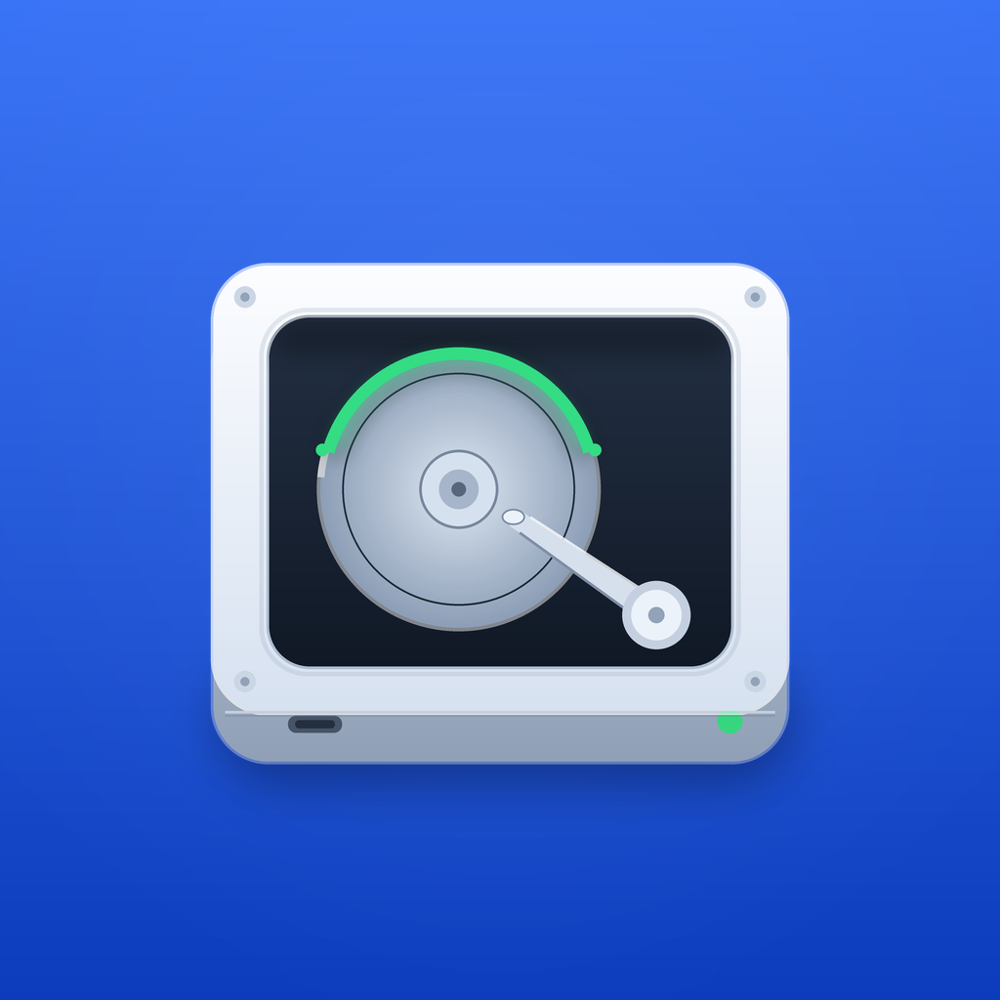
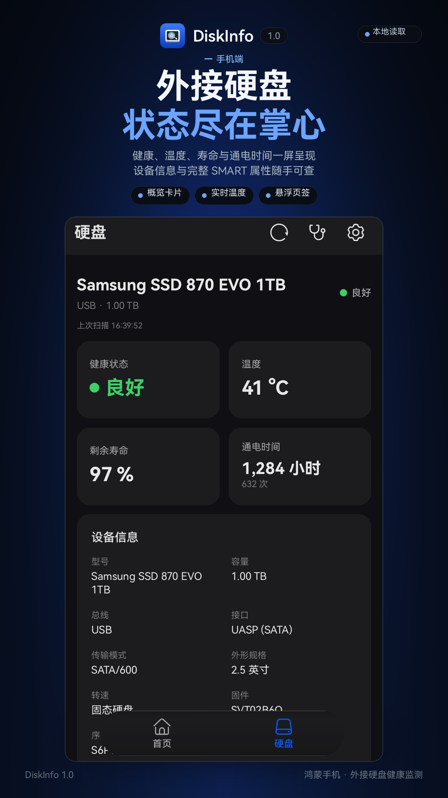
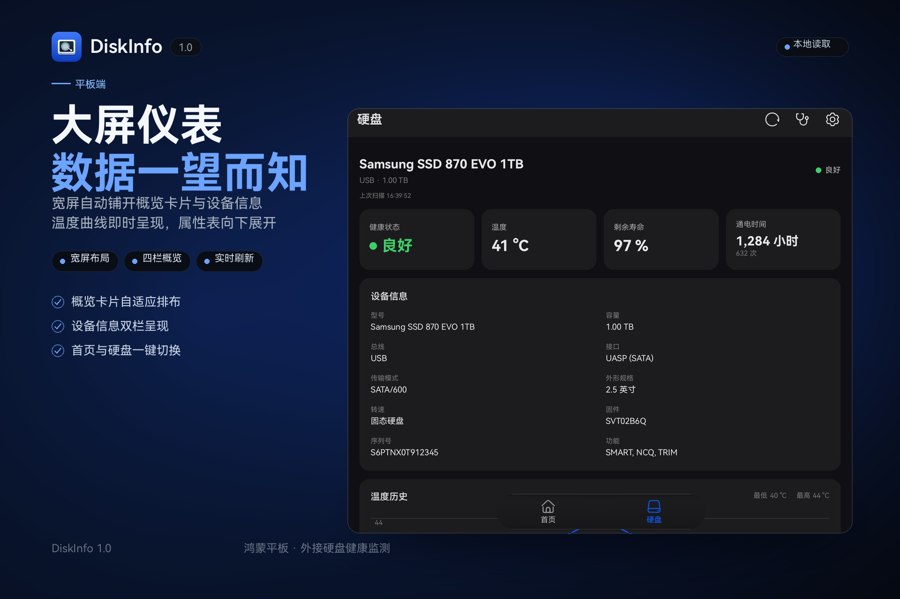
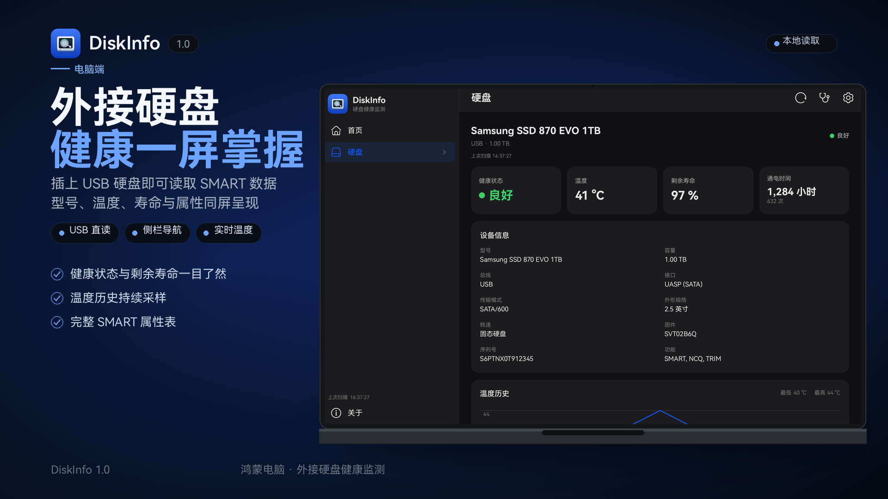

# DiskInfo

专为外接 USB 硬盘提供 SMART 健康监测。在 HarmonyOS 手机、平板与电脑上，读取健康状态、温度、通电时间、剩余寿命与完整 SMART 属性；内置硬盘不参与检测。

## 功能

- **外接 USB 硬盘**：插入硬盘或硬盘盒后自动扫描，识别型号、容量、总线、接口、传输模式、外形规格与转速
- **健康概览**：健康状态、温度、剩余寿命、通电时间与通电次数一屏呈现
- **SMART 属性**：完整属性名称、当前值、最差值、阈值与原始值，原始值支持十进制 / 十六进制
- **温度历史**：按扫描记录温度变化，显示最低与最高
- **告警与阈值**：温度告警；重映射、待映射、无法修正磁区与寿命告警阈值可调
- **诊断**：USB 通道消息与读取异常排查
- **本机读取**：所有数据在本机处理，不上传网络
- **外观与语言**：跟随系统 / 浅色 / 深色，四种按钮色彩；简体中文、繁體中文、English、日本語、한국어、Русский
- **自适应布局**：手机与平板使用悬浮底部页签（首页 / 硬盘），电脑使用侧栏（首页 / 硬盘 / 关于）

| 手机 | 平板 | 电脑 |
| --- | --- | --- |
|  |  |  |

## 环境

- HarmonyOS API 26 及以上（`compatibleSdkVersion 26.0.0`）
- DevEco Studio（支持 API 26）
- SMART 解释核心使用 C++ 编写，通过 NAPI 接入；USB ATA pass-through 由 ArkTS 侧完成

## 构建

1. 签名配置：复制 `build-profile.json5.sample` 为 `build-profile.json5`，在 DevEco Studio 中配置本地签名（`build-profile.json5` 已被 `.gitignore` 排除，避免提交签名口令与证书路径）。

2. 使用 DevEco Studio 打开工程构建。C++ SMART 解释核心由 hvigor 通过 CMake 自动编译，无需单独构建原生库。

## 目录

- `entry/` — HarmonyOS 应用（ArkTS UI、页面与组件）
- `entry/src/main/cpp/` — C++ SMART 解释核心与 NAPI 桥接
- `entry/src/main/resources/rawfile/` — SMART 名称字典与许可全文
- `tools/` — 应用图标与商店宣传图生成脚本
- `store/` — 应用商店图标与宣传图
- `icon-build/` — 分层图标源文件与导出预览

## 开源许可

DiskInfo 以 MIT 许可证开源，全文见 [LICENSE](LICENSE)。SMART 解释引擎移植自 CrystalDiskInfo；上游 MIT 许可、随应用分发的第三方组件与资源声明见 [DiskInfo_THIRD_PARTY_NOTICES.md](DiskInfo_THIRD_PARTY_NOTICES.md)，应用内「关于 → 开源许可」提供同样的完整清单。

| 项目 | 角色 | 许可证 | 地址 |
| --- | --- | --- | --- |
| DiskInfo | 本项目 | MIT | https://github.com/IChuJianI/DiskInfo |
| CrystalDiskInfo | SMART 解释引擎（上游） | MIT | https://github.com/hiyohiyo/CrystalDiskInfo |

## 作者

李晨 · 3093376617@qq.com
